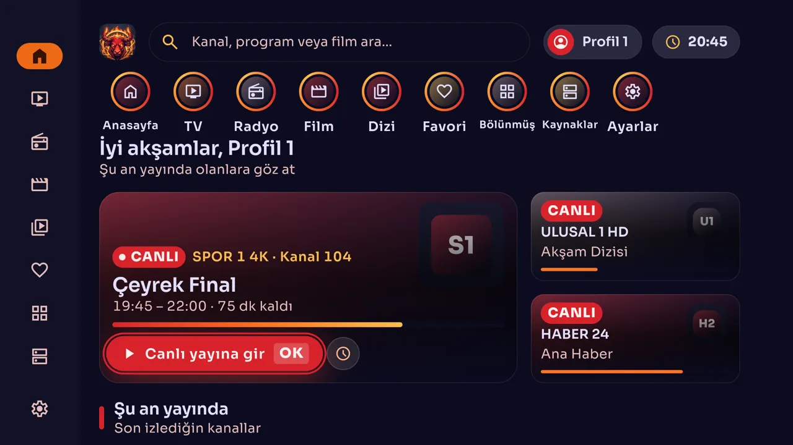
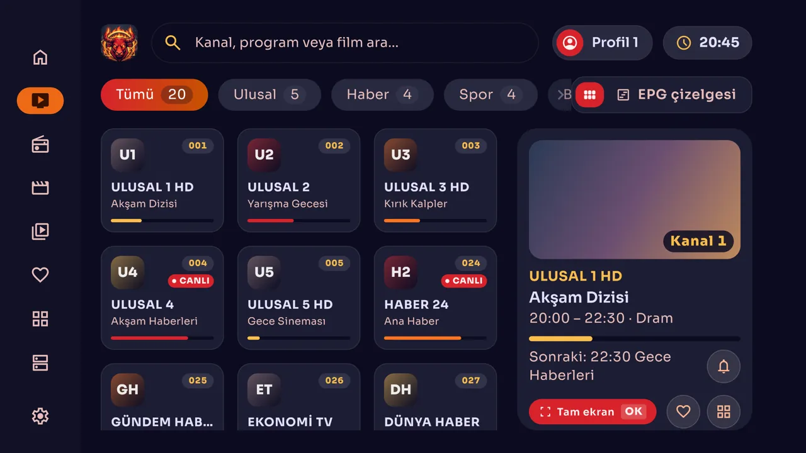
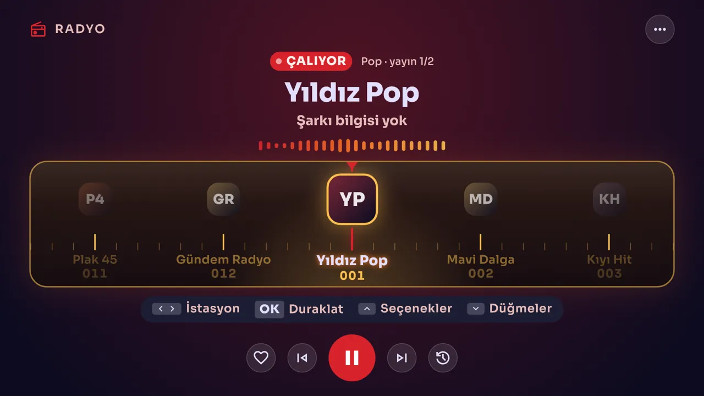
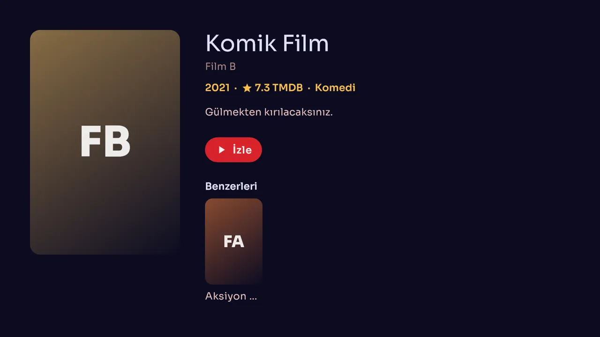
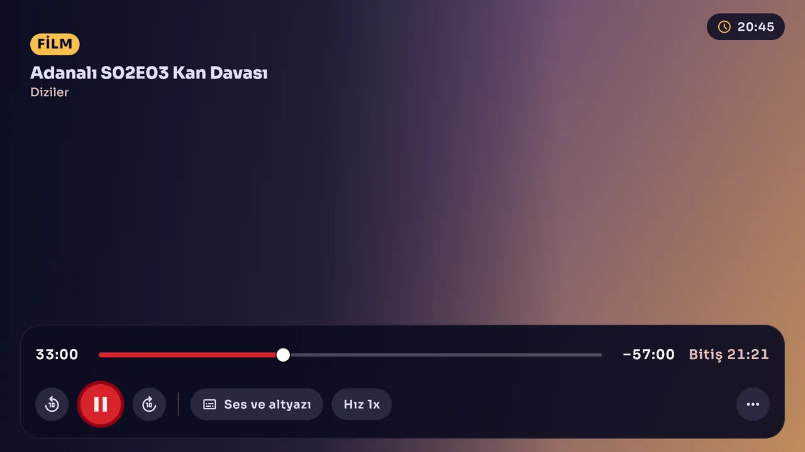
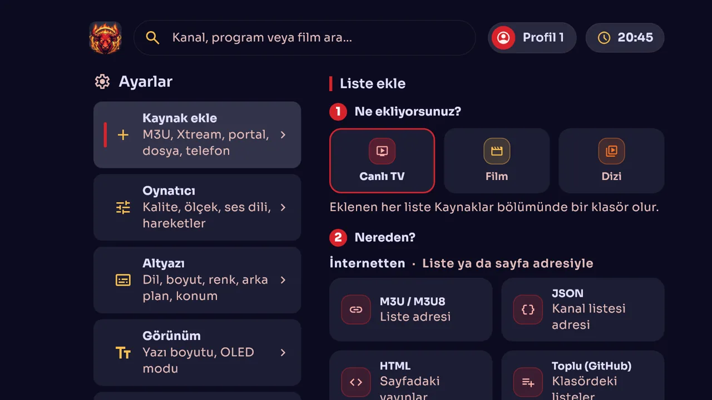
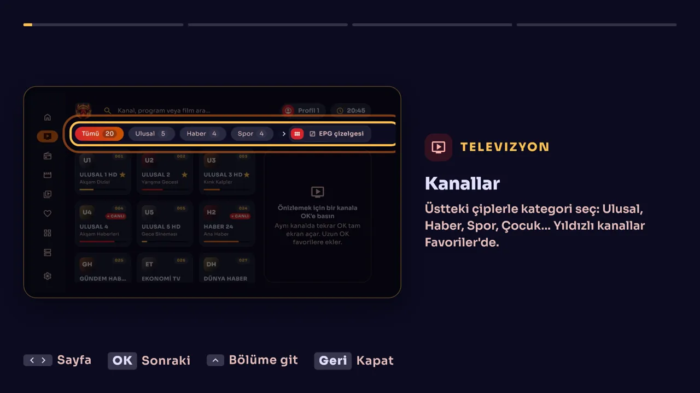
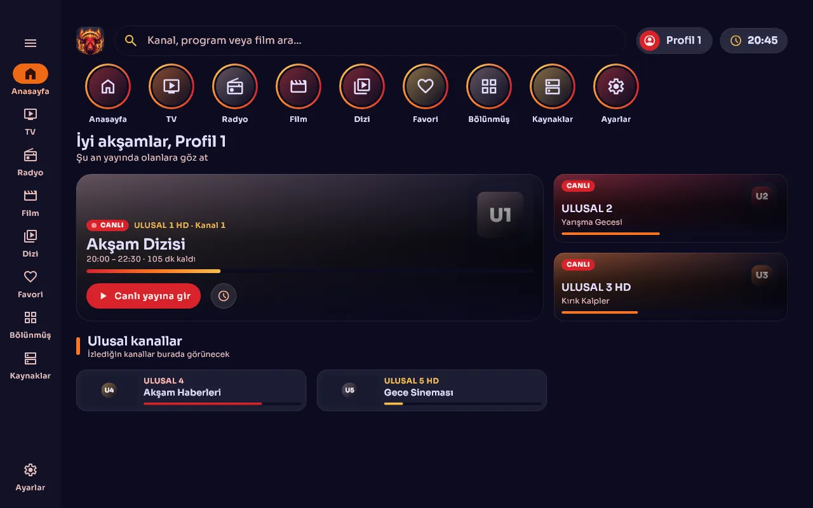
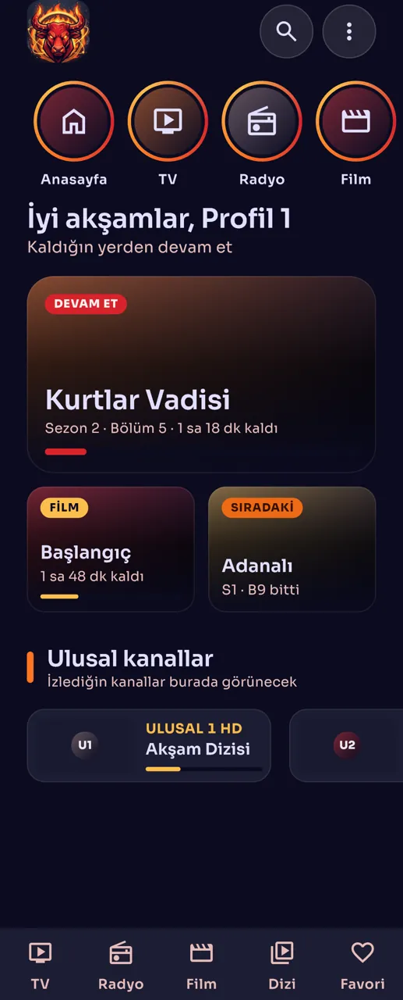

<p align="center">
  
</p>

<h1 align="center">RedoX TV 3</h1>

<p align="center">
  Android TV, tablet, telefon ve Windows için IPTV oynatıcı<br>
  IPTV player for Android TV, tablet, phone and Windows
</p>

<p align="center">
  <a href="#türkçe"><b>Türkçe</b></a> ·
  <a href="#english"><b>English</b></a> ·
  <a href="https://github.com/ByReDoxXx/RedoX-TV-3/wiki"><b>Wiki</b></a> ·
  <a href="https://github.com/ByReDoxXx/RedoX-TV-3/releases/latest"><b>İndir / Download</b></a>
</p>

---

## Türkçe

RedoX TV; canlı TV, radyo, film ve dizi listelerinizi tek uygulamada toplayan bir IPTV oynatıcıdır. Her cihazda o cihaza uygun arayüzle açılır: TV'de kumanda, tablet ve telefonda dokunma, Windows'ta fare ve klavye.

### Ekran görüntüleri

| Televizyon | Radyo |
|---|---|
|  |  |

| Film | Oynatıcı |
|---|---|
|  |  |

| Kaynak ekleme | Öğretici hikâyeler |
|---|---|
|  |  |

| Tablet | Telefon |
|---|---|
|  |  |

> Görüntülerdeki kanal, film ve dizi adları örnek veridir. Daha fazlası için [Wiki](https://github.com/ByReDoxXx/RedoX-TV-3/wiki).

### Özellikler

- **Canlı TV:** Kategoriler, canlı önizleme, EPG çizelgesi, program hatırlatma, kanal numarasıyla geçiş.
- **Radyo:** Türlere ayrılmış liste, kadran, şarkı adı, son çalan şarkılar, başka bölümde gezerken çalmaya devam.
- **Film ve dizi:** Afişler ve TMDB bilgileri (kendi TMDB anahtarınızla); kategori, tür ve yıl süzgeci; sezon ve bölüm düzeni; kaldığın yerden devam.
- **Arama:** Kanal, program, radyo, film ve dizide tek kutudan; Türkçe harf yazmasan da bulur.
- **Oynatıcı:** media_kit tabanlı; kalite, ses ve altyazı seçimi, uyku zamanlayıcısı.
- **Bölünmüş ekran:** Aynı anda 2 ya da 4 kanal.
- **Kaynaklar:** M3U/M3U8, JSON, HTML sayfası, toplu liste (GitHub klasörü), Xtream, MAC/STB portal, dosya, USB/SSD klasörü, telefondan QR ile gönderme.
- **Profiller:** Çocuk profili, ebeveyn PIN'i, kilitli içerik.
- **Telefon kumandası:** Telefonu TV'nin kumandası olarak kullanma.
- **Klavye ve fare:** Android TV'de de var; fare kullanılınca arayüz fareye uygun düzene geçer.
- **Öğretici hikâyeler:** Anasayfa'da her bölümü o cihazın ekran görüntüleriyle anlatır.

### İndirme ve kurulum

[Son sürümden](https://github.com/ByReDoxXx/RedoX-TV-3/releases/latest) cihazınıza uygun dosyayı indirin:

| Cihaz | Dosya |
|---|---|
| Chromecast ve çoğu Android TV | `RedoX-TV-<sürüm>-tv-armeabi-v7a.apk` |
| 64 bit Android TV | `RedoX-TV-<sürüm>-tv-arm64-v8a.apk` |
| Telefon | `RedoX-TV-<sürüm>-telefon-arm64-v8a.apk` |
| Tablet | `RedoX-TV-<sürüm>-tablet-arm64-v8a.apk` |
| Eski telefon ve tabletler | Aynı adların `armeabi-v7a` sürümü |
| Windows (64 bit) | `RedoX-TV-<sürüm>-windows-x64.zip` |

- **Android:** APK'yı açın; sorarsa bilinmeyen kaynaklardan kuruluma izin verin. Android TV için [Kurulum](https://github.com/ByReDoxXx/RedoX-TV-3/wiki/Kurulum) sayfasına bakın.
- **Windows:** Zip'i bir klasöre açıp `redox_tv.exe`'yi çalıştırın. Uygulama imzasızdır, SmartScreen uyarı verebilir. Tam ekran açılır; çıkmak için ana ekranda Esc'e iki kez ya da Alt+F4'e basın.
- **Linux:** v3.0.0'da hazır paket yoktur; kaynaktan derlenir.

### Kaynaktan derleme

Gerekenler: Flutter 3.47.9, Android SDK ve Java 17. Windows için ayrıca Visual Studio C++ araçları.

Android'de televizyon, tablet ve telefon ayrı APK'lardır, `--flavor` her zaman verilir:

```bash
flutter pub get
flutter build apk --release --flavor tv --split-per-abi --dart-define-from-file=keys.json
flutter build apk --release --flavor tablet --split-per-abi --dart-define-from-file=keys.json
flutter build apk --release --flavor phone --split-per-abi --dart-define-from-file=keys.json
flutter build windows --release --dart-define-from-file=keys.json
flutter build linux --release --dart-define-from-file=keys.json
```

`keys.json` depoda yoktur; kendiniz oluşturursunuz ve hiçbir yere yüklemezsiniz:

```json
{ "REDOX_DATA_KEY": "<şifreli veri paketlerinin anahtarı>" }
```

- Uygulamayla gelen şifreli kanal ve radyo paketleri `REDOX_DATA_KEY` olmadan açılmaz.
- TMDB anahtarı derlemeye girmez; her kullanıcı kendi anahtarını uygulamada **Ayarlar › Veriler**'den girer. Girilmezse afiş ve özet gelmez.
- Windows derlemesi NTFS sürücü ister; exFAT'ta sembolik bağlantı hatası verir.
- Sürüm imzası `key.properties` dosyasından okunur; dosya yoksa debug imzası kullanılır.

### Test

```bash
flutter analyze
flutter test
REDOX_SNAPSHOT=1 flutter test    # ekran görüntülerini build/ altına yazar
```

### Proje yapısı

```text
lib/core/       Oynatma motoru, içerik, tema, ortak bileşenler
lib/features/   Anasayfa, TV, radyo, kütüphane, oynatıcı, kaynaklar, ayarlar, hikâyeler
assets/         Şifreli veri paketleri, yazı tipi, marka, hikâye görüntüleri
design/         Tasarım sistemi ve kararlar
test/           Birim, bileşen ve ekran görüntüsü testleri
tools/          Veri ve görüntü üretim araçları
```

GitHub Actions yalnız `v*` etiketinde ya da elle başlatılınca derler.

### Yasal not

RedoX TV bir oynatıcıdır. Eklediğiniz listelerden ve bunların içeriğinden siz sorumlusunuz; yayın hakkına sahip olmadığınız içerikleri kullanmayın.

---

## English

RedoX TV is an IPTV player that brings your live TV, radio, movie and series lists into one app. Each device gets its own interface: remote control on TV, touch on tablet and phone, mouse and keyboard on Windows.

The screenshots above show live TV, radio, movie details, the player, adding a source and the tutorial stories, followed by the tablet and phone layouts. The interface is in Turkish; channel, movie and series names are sample data. See the [English guide](https://github.com/ByReDoxXx/RedoX-TV-3/wiki/English-Guide) for more.

### Features

- **Live TV:** Categories, live preview, EPG grid, program reminders, jumping to a channel by number.
- **Radio:** Stations by genre, tuning dial, song titles, recently played songs, playback while you browse the app.
- **Movies and series:** Posters and TMDB details (with your own TMDB key); category, genre and year filters; seasons and episodes; resume where you left off.
- **Search:** One box for channels, programs, radio, movies and series; works without typing Turkish letters.
- **Player:** Built on media_kit; quality, audio and subtitle selection, sleep timer.
- **Split screen:** 2 or 4 channels at once.
- **Sources:** M3U/M3U8, JSON, HTML page, bulk lists (GitHub folder), Xtream, MAC/STB portal, file, USB/SSD folder, sending from your phone by QR code.
- **Profiles:** Kids profile, parental PIN, locked content.
- **Phone remote:** Use your phone as the TV's remote control.
- **Keyboard and mouse:** Also on Android TV; the interface adapts when a mouse is used.
- **Tutorial stories:** The home page explains each section with screenshots from your type of device.

### Download and install

Get the right file from the [latest release](https://github.com/ByReDoxXx/RedoX-TV-3/releases/latest):

| Device | File |
|---|---|
| Chromecast and most Android TVs | `RedoX-TV-<version>-tv-armeabi-v7a.apk` |
| 64-bit Android TV | `RedoX-TV-<version>-tv-arm64-v8a.apk` |
| Phone | `RedoX-TV-<version>-telefon-arm64-v8a.apk` |
| Tablet | `RedoX-TV-<version>-tablet-arm64-v8a.apk` |
| Older phones and tablets | The `armeabi-v7a` build with the same name |
| Windows (64-bit) | `RedoX-TV-<version>-windows-x64.zip` |

- **Android:** Open the APK and allow installing from unknown sources if asked.
- **Windows:** Extract the zip and run `redox_tv.exe`. The app is unsigned, so SmartScreen may warn you. It opens full screen; press Esc twice on the home screen or Alt+F4 to quit.
- **Linux:** v3.0.0 has no prebuilt package; build it from source.

### Building from source

You need Flutter 3.47.9, the Android SDK and Java 17, plus the Visual Studio C++ tools for Windows.

TV, tablet and phone are separate Android APKs, so always pass `--flavor`:

```bash
flutter pub get
flutter build apk --release --flavor tv --split-per-abi --dart-define-from-file=keys.json
flutter build apk --release --flavor tablet --split-per-abi --dart-define-from-file=keys.json
flutter build apk --release --flavor phone --split-per-abi --dart-define-from-file=keys.json
flutter build windows --release --dart-define-from-file=keys.json
flutter build linux --release --dart-define-from-file=keys.json
```

`keys.json` is not in the repository. Create your own and never upload it:

```json
{ "REDOX_DATA_KEY": "<key for the encrypted data packs>" }
```

- The bundled encrypted channel and radio packs do not open without `REDOX_DATA_KEY`.
- The TMDB key is not built into the app; each user enters their own in the app under **Ayarlar › Veriler** (Settings › Data). Without it, movie and series details are not loaded.
- The Windows build needs an NTFS drive; exFAT fails with a symlink error.
- Release signing reads `key.properties`; without it, the debug signature is used.

### Testing

```bash
flutter analyze
flutter test
REDOX_SNAPSHOT=1 flutter test    # writes screenshots under build/
```

### Project layout

```text
lib/core/       Playback engine, content, theme, shared widgets
lib/features/   Home, TV, radio, library, player, sources, settings, stories
assets/         Encrypted data packs, fonts, branding, story images
design/         Design system and decisions
test/           Unit, widget and screenshot tests
tools/          Data and image generators
```

GitHub Actions builds only on `v*` tags or when started manually.

### Legal note

RedoX TV is a player. You are responsible for the lists you add and their content; do not use content you have no right to access.
